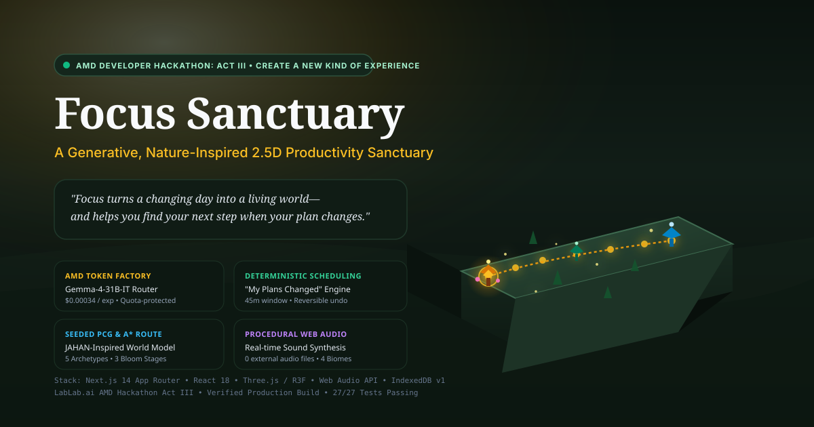

# Focus — A Living 2.5D Productivity Sanctuary for Changing Days



> **Central Product Promise:** *"Focus turns a changing day into a living world—and helps you find your next step when your plan changes."*

Built for the **LabLab.ai — AMD Developer Hackathon: ACT III** (**Track:** *"Create a New Kind of Experience"*).

---

## 1. What Focus Is (And Why We Built It)

Conventional task managers represent goals as flat rows or rigid calendar boxes. When real life interrupts a planned day—turning a 3.5-hour work window into 45 minutes—static lists silently turn into overdue red text, forcing the user to mentally recalculate priorities, durations, and dependencies from scratch.

**Focus** explores a testable alternative:
1. **Natural-Language Goal Capture:** State your intentions in plain language (*"Study for an hour, finish my assignment, go for a walk, and call my friend"*).
2. **AMD-Accelerated Semantic Interpretation:** Our server-side router queries **AMD Token Factory** (`Gemma-4-31B-IT` primary / `DeepSeek-V4.1-Flash` fallback) to propose editable tasks and a constrained atmospheric `WorldProfile`.
3. **Deterministic Scheduling & Seeded 2.5D World:** A pure TypeScript scheduling engine validates the dependency DAG, allocates feasible time slots with adaptive buffers, and maps each task onto an interactive architectural landmark connected by an **A* stepping-stone route**.
4. **Interruption-Aware Replanning ("My Plans Changed"):** When your day shrinks to 45 minutes, Focus preserves completed landmarks in full bloom, recalculates the single viable next step, calmly transitions non-fitting tasks into a resting state with honest explanations, and crossfades the visual biome and Web Audio soundscape.

---

## 2. Two-Scenario Live Demo Proof

Focus demonstrates two materially different, context-responsive experiences within a unified artistic universe:

| Dimension | Scenario A: Full Study & Restoration Day (210m) | Scenario B: Interrupted Day — Only 45m Remain |
| :--- | :--- | :--- |
| **User Context** | *"Study for an hour, finish my assignment, go for a walk, and call my friend."* (`210 min` budget) | User completes *Study*, then triggers **"My Plans Changed"**: *"I only have 45 minutes left now."* |
| **World Profile & Biome** | `SUNLIT_GLADE` — Warm morning sunlight, dappled moss, golden beacon path. | `MISTY_ZEN_STREAM` — Grounded jade mist, higher brook presence, calm recalibration. |
| **Deterministic Schedule** | Schedules all 4 tasks sequentially with 5-minute transition buffers (`155m` scheduled, `55m` slack). | Preserves `Study` (`Completed`). Schedules `Finish my assignment` (`45m`) as the single active Next Step. Marks `Walk` (`30m`) and `Call` (`~20m est.`) as `Deferred` (`INSUFFICIENT_REMAINING_TIME`). |
| **2.5D Visual & Audio Response** | `Study Nook` blooms with flowers and lantern light upon completion; firefly guide traverses all 4 stops. | `Study Nook` stays in bloom; A* path highlights only the route to `Writing Pavilion`; soundscape crossfades via a grounding Fmaj7 -> Cmaj7 cadence. |

---

## 3. Mandatory AMD Technology Integration

Focus uses **AMD Token Factory** (`https://developer.amd.com.cn/radeon/api/v1`) as a real server-side runtime dependency:
- **Server-Only Security:** All model requests execute inside Next.js App Router server routes (`/api/ai/models`, `/api/ai/plan`, `/api/ai/replan`) guarded by `import 'server-only'`. Your `AMD_TOKEN_FACTORY_API_KEY` never reaches the browser bundle.
- **Dynamic `/models` Discovery:** `getDiscoveredModelCatalogue()` queries `GET /models` at runtime, matching preferred candidates (`Gemma-4-31B-IT`, `DeepSeek-V4.1-Flash`, `Qwen3.8-Flash-Next`) and caching metadata for 5 minutes.
- **Quota-Safe Caching & Degraded Mode:** Identical normalized prompts hit an in-memory SHA-256 cache (`0 pts` consumed). If the API key is omitted or account quota (`429`) is reached, Focus halts model retries immediately and falls back to `heuristicFallback.ts` without losing user input.
- **Judge Inspection ("AMD Lab" Drawer):** Click **AMD Lab** in the top-right bar to inspect live `/models` discovery, active model ID, latency (ms), prompt/completion tokens, and unit-economics cost calculations.

---

## 4. Research Foundation & Scientific Guardrails

### A. Working Memory & Post-Distraction Replanning
Inspired by experimental cognitive psychology research from the **Jarrod Lewis-Peacock Lab** ([lewpealab.org/papers](https://www.lewpealab.org/papers)):
- **Peer-Reviewed Paper:** Zhang, Z., & Lewis-Peacock, J. A. (2026). *"Working memory constraints on replanning following distraction."* **Communications Psychology** (Published 10 July 2026). DOI: `10.1038/s44271-026-00497-6`
- **Preprint (Unrefereed):** Zhang, Z., & Lewis-Peacock, J. A. (2026). *"Working memory adaptively recomputes plans amid distraction."* **bioRxiv** (Posted 9 August 2026). DOI: `10.64898/2026.08.03.742569`
- **Epistemic Guardrail:** Focus is a **product design exploration**, not a clinical intervention or validated cognitive treatment. It does not claim to increase working memory capacity or treat ADHD.

### B. Procedural Content Generation (PCG)
- **LLM + PCG Hybrid Separation:** Maleki, M. F., & Zhao, R. (2024). *"Procedural Content Generation in Games: A Survey with Insights on Emerging LLM Integration."* `arXiv:2410.15644`
- **Quality, Diversity & Controllability Metrics:** Khalifa, A., et al. (2025). *"The Procedural Content Generation Benchmark."* `arXiv:2503.21474`
- **Modular Constructive Pipeline & Assertions:** Amiri-Chimeh, S., Haghighi, H., & Vahidi-Asl, M. (2024). *"JAHAN: A framework for procedural generation of game maps from design specifications."* **Entertainment Computing**, 50, 100644.
- **Local Constraints vs. Global Connectivity:** Bhaumik, D., et al. (2026). *"Learning Local Constraints for Reinforcement-Learned Content Generators."* `arXiv:2605.13570`

---

## 5. Unit Economics & Cost Per Generated Experience

- **Hackathon Shared API Cost:** `$0.00` billed USD (governed by shared Token Factory rate/quota limits).
- **Production Cloud Inference Formula:**
  A single plan or replan generation averages **~650 prompt tokens** and **~350 completion tokens** (`1,000 total tokens`). At standard open-weights cloud inference rates on AMD Instinct GPUs (`$0.20 / 1M input tokens`, `$0.60 / 1M output tokens`):
  - **Cost per Generated Experience:** `(650 * $0.20 + 350 * $0.60) / 1,000,000 = $0.00034 USD` (**0.034 cents**)
  - **Monthly Active User Cost (75 calls/month = 3 calls/day × 25 days):** `75 * $0.00034 = $0.0255 USD / user / month` (**~2.6 cents/month**)

---

## 6. Local Setup & Verification (Windows PowerShell & macOS/Linux)

### Prerequisites
- **Node.js** `v18.18+` or `v20+`
- **Visual Studio Code**

### 1. Install Dependencies
```bash
npm install
```

### 2. Configure Environment Variables
Copy `.env.example` to `.env.local`:

Windows PowerShell:
```powershell
Copy-Item .env.example .env.local
```

macOS / Linux:
```bash
cp .env.example .env.local
```

Open `.env.local` and set your personal `AMD_TOKEN_FACTORY_API_KEY`. (If left as `put_your_key_here`, Focus automatically runs in deterministic local fallback mode so all features and demos work out of the box.)

### 3. Run Automated Unit & Integration Tests (Vitest)
```bash
npm test
```

### 4. Start the Local Development Server
```bash
npm run dev
```
Open `http://localhost:3000` in your desktop browser.

### 5. Verify Production Build
```bash
npm run build
npm start
```

---

## 7. Deploy to Vercel

Focus is pre-configured for one-click deployment on [Vercel](https://vercel.com):

1. Push this repository to your GitHub account (`https://github.com/awaisstack/focus`).
2. In the [Vercel Dashboard](https://vercel.com/new), select **Import Git Repository** and choose `awaisstack/focus`.
3. Framework Preset will be automatically detected as **Next.js**.
4. In **Environment Variables**, optionally add:
   - `AMD_TOKEN_FACTORY_API_KEY`: Your AMD Token Factory API key (if omitted, the app smoothly uses the deterministic local fallback planner).
   - `AMD_TOKEN_FACTORY_BASE_URL`: `https://developer.amd.com.cn/radeon/api/v1`
5. Click **Deploy**!

---

## 8. Privacy Notice
- **Local-First Storage:** Your tasks, world seed, landmark progression, and audio preferences are stored locally in your browser’s IndexedDB (`focus-sanctuary-db`). You can export or wipe your local data at any time inside the AMD Lab drawer.
- **Hosted Inference:** When an AMD Token Factory API key is configured and you submit a natural-language goal or interruption note, only the prompt text and current task titles/durations are sent over HTTPS to the configured AMD endpoint. API keys and raw user prompts are never written to server logs or client bundles.

---

## License
MIT License — see `ASSET_CREDITS.md` and `DECISIONS.md`.
